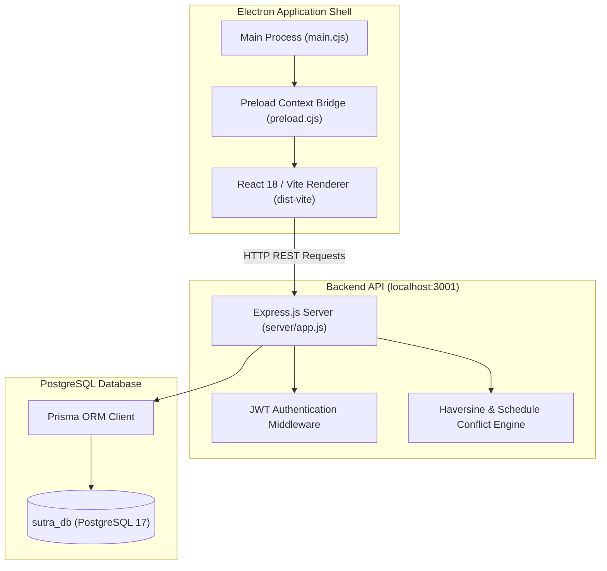

# SUTRA — Smart Urban Taskforce & Resource Alliance

> **Lean Electron Desktop Application for Interdepartmental Municipal Infrastructure Coordination**  
> Developed for Indian cities under civic coordination frameworks recommended by the Ministry of Housing and Urban Affairs (MoHUA).

[-0f172a?style=flat&logo=apple)](https://github.com/aryachadha/SUTRA)
[](https://github.com/aryachadha/SUTRA)
[](https://github.com/aryachadha/SUTRA)

---

## 1. Project Overview & Problem Statement

In Indian urban areas, civic authorities—such as Municipal Corporations, the Public Works Department (PWD), Water Supply Boards (PHED), Electricity Distribution Companies (DISCOMs), and City Gas Utilities—frequently dig up roads and execute infrastructure projects at identical physical locations without mutual schedule coordination. 

This uncoordinated execution results in:
1. **Pavement Destruction:** Newly laid bitumen or concrete roads being cut open weeks after completion.
2. **Infrastructure Collisions:** Underground drinking water mains or power cables accidentally ruptured during trenching.
3. **Escalated Expenditure:** Duplicate excavation, subgrade reinstatement, and traffic detour costs.
4. **Public Disruption:** Prolonged vehicular congestion, water outages, and citizen dissatisfaction.

**SUTRA (Smart Urban Taskforce & Resource Alliance)** is a lean, focused desktop application designed to solve this problem. It serves as a unified digital interface where departments register planned and active civil works, automatically detect location and scheduling conflicts before excavation begins, coordinate joint utility ducting, share heavy capital equipment, and resolve site challenges through an interdepartmental coordination forum.

---

## 2. Core Functional Modules

SUTRA is structured around six core modules:

### Module 1: Municipal Dashboard
- High-level overview of city infrastructure coordination metrics:
  - Total registered municipal departments
  - Active and planned infrastructure projects
  - Interdepartmental projects with multi-agency participation
  - Pending coordination issues (spatial & scheduling conflicts)
  - Upcoming completion deadlines (next 30 days)
- Live project status breakdown (Proposed, Planned, In Progress, On Hold, Completed).
- High-priority alert feed showcasing projects requiring immediate interdepartmental attention.
- Quick actions: Create Project, Register Department, and Re-run Conflict Detection.
- Clearly demarcated synthetic demonstration dataset (Jaipur Smart Urban Corridor, Rajasthan).

### Module 2: Department Directory
- Comprehensive registry of city departments and utility service agencies (e.g., PWD, PHED, JMC, JVVNL, RSGL).
- Contact officer details, official emails, telephone lines, and agency jurisdictions.
- Direct drill-down into each department's active projects and shared equipment inventory.
- Full administrative capabilities: add, update, and manage agency records.

### Module 3: Project Management & Coordination
- Lifecycle tracking for municipal infrastructure undertakings.
- Detailed project parameters:
  - Title, unique alphanumeric project code (e.g. `PWD-2026-001`)
  - Owning department and multi-agency participating departments
  - Geographic location name and decimal latitude/longitude coordinates
  - Execution timeline (start date, end date)
  - Responsible executive officer
  - Priority level (`LOW`, `MEDIUM`, `HIGH`, `CRITICAL`)
  - Progress tracking (0%–100%) and estimated budget (₹ in Lakhs)
- Automatic conflict detection triggered upon project creation or coordinate/timeline adjustments.

### Module 4: Interactive Project Map & Conflict Detection
- **Interactive Geospatial Visualization:** Powered by Leaflet and OpenStreetMap tiles.
- **Automated Conflict Detection Engine:** Employs a dual-condition algorithm:
  1. **Geospatial Proximity:** Calculates exact distance in meters between project sites using the spherical Haversine formula (Earth radius $R = 6,371\text{ km}$). Projects within a 500-meter buffer radius are flagged.
  2. **Temporal Schedule Overlap:** Evaluates start and end dates with a configurable buffer window (14 days) to detect overlapping construction periods.
- **Intelligent Coordination Recommendations:** Automatically analyzes department types (e.g., Roads + Water) and suggests specific field engineering actions:
  - *Roads + Water:* "Sequence deep trench water pipeline installation prior to sub-base and bitumen road resurfacing. Conduct joint alignment inspection."
  - *Roads + Power:* "Establish common underground cable conduit ducting to prevent post-pavement excavation. Share utility maps."
  - *Roads + Gas:* "Verify minimum safety depth (1.2m) for MDPE gas piping before road milling/compaction works."
- **Conflict Workflow & Resolution:** Allows authorized engineers to mark conflicts as `UNDER_REVIEW`, `RESOLVED`, or `DISMISSED` with formal audit notes.
- **One-Click Coordination:** Spawns a dedicated interdepartmental discussion thread pre-populated with conflicting project parameters.

### Module 5: Shared Resource Inventory
- Capital equipment inventory sharing between municipal departments:
  - Heavy crawler excavators, backhoe loaders
  - Vibratory tandem road rollers
  - Underground precision pipe & cable locators
  - Robotic CCTV mainline sewer inspection crawlers
  - Mobile diesel generator vans (125 kVA)
  - Robotic total stations & RTK DGPS survey kits
- Reservation request system with requesting department, purpose, and required dates.
- **Concurrency & Booking Conflict Prevention:** Uses database transactions (`prisma.$transaction`) to prevent double-booking of equipment during overlapping time intervals.

### Module 6: Basic Discussion Forum
- Interdepartmental forum for direct coordination between agency engineers.
- Thread creation linked directly to municipal projects or conflict cases.
- Real-time departmental replies, author designation tracking, and chronological discussion feeds.

---

## 3. Technology Stack

Built strictly in **JavaScript** without TypeScript:

- **Desktop Framework:** Electron 33 (Secure architecture: `contextIsolation: true`, `nodeIntegration: false`, preload bridge, CSP)
- **Frontend UI:** React 18, Vite 5, Tailwind CSS, Lucide React
- **Navigation:** React Router 6 (`HashRouter` for desktop file protocol compatibility)
- **Map & GIS:** Leaflet 1.9, OpenStreetMap
- **Backend API:** Node.js, Express.js (REST API, CORS, centralized error handling)
- **Database & ORM:** PostgreSQL 17, Prisma ORM 5
- **Authentication:** JSON Web Tokens (JWT) & bcrypt password hashing
- **Testing:** Node.js native test runner (`node --test`), assert primitives
- **Packaging:** electron-builder (Target: macOS Apple Silicon `.dmg`)

---

## 4. Architecture & Security



### Electron Security Measures
1. **Context Isolation:** Enabled (`contextIsolation: true`) to ensure renderer scripts cannot manipulate the main process prototype.
2. **Node Integration Disabled:** (`nodeIntegration: false`) prevents renderer processes from executing raw Node.js or OS commands.
3. **Restricted Preload API:** Only whitelisted helper methods (`getAppVersion`, `openExternal`, `showNotification`) are exposed via `contextBridge`.
4. **Content Security Policy (CSP):** Enforced in `index.html` allowing only necessary tile domains and local API connections.
5. **Safe External Navigation:** Links open externally via `shell.openExternal` after HTTP/HTTPS scheme validation.

---

## 5. Getting Started & Installation

### Prerequisites
- macOS 13+ (Ventura, Sonoma, Sequoia)
- Node.js v20+ or v22+
- npm v10+
- PostgreSQL v15+ (PostgreSQL 17 recommended, running on port 5432)

### 1. Clone the Repository
```bash
git clone https://github.com/aryachadha/SUTRA.git
cd SUTRA
```

### 2. Configure Environment Variables
Copy `.env.example` to create your local `.env`:
```bash
cp .env.example .env
```
Ensure your database connection string in `.env` matches your local PostgreSQL setup:
```env
DATABASE_URL="postgresql://aryachadha@localhost:5432/sutra_db?schema=public"
PORT=3001
NODE_ENV=development
JWT_SECRET="sutra-urban-taskforce-secret-key-2026-jaipur"
CONFLICT_DISTANCE_METERS=500
CONFLICT_WINDOW_DAYS=14
DEFAULT_CITY="Jaipur"
DEFAULT_LATITUDE=26.9124
DEFAULT_LONGITUDE=75.7873
```

### 3. Install Dependencies
```bash
npm install
```

### 4. Database Setup & Migrations
Create the PostgreSQL database and run Prisma migrations:
```bash
# Create database (if not already created)
createdb sutra_db

# Push schema and generate Prisma client
npm run db:push
npm run db:generate
```

### 5. Seed Demonstration Dataset
Seed synthetic Jaipur municipal data (departments, users, projects with intentional conflicts, resources, and discussions):
```bash
npm run db:seed
```

---

## 6. Development & Run Commands

| Command | Description |
| :--- | :--- |
| `npm run dev` | Runs backend server, Vite dev server, and Electron application concurrently. |
| `npm run dev:server` | Starts the Express REST API backend on `http://127.0.0.1:3001`. |
| `npm run dev:vite` | Starts the Vite React development server on `http://localhost:5173`. |
| `npm run start` | Launches Electron with the built frontend. |
| `npm test` | Runs the automated test suite (unit and API integration tests). |
| `npm run build:vite` | Compiles the React frontend into `dist-vite/`. |
| `npm run build:electron` | Packages the application into an installable macOS DMG using electron-builder. |
| `npm run build` | Full production build (Vite + Electron DMG). |

---

## 7. Automated Test Suite

SUTRA includes an automated JavaScript test suite covering security primitives, spatial algorithms, reservation concurrency, and API endpoints:

```bash
npm test
```

### Verified Test Areas:
1. **Haversine Distance Algorithm:** Validates great-circle distance calculations between Jaipur landmarks (~130m along MI Road; ~9.5km between Mansarovar and Walled City).
2. **Temporal Overlap Logic:** Validates date arithmetic and schedule overlaps.
3. **Conflict Detection Engine:** Asserts detection when spatial proximity &le; 500m and schedules overlap; verifies non-detection for distant or non-overlapping projects.
4. **Resource Concurrency:** Validates detection of overlapping reservations for identical equipment.
5. **Authentication & Cryptography:** Tests bcrypt hash generation and JWT token signing/verification.
6. **API Integration Suite:** Tests all REST endpoints (`/api/health`, `/api/auth/login`, `/api/dashboard/stats`, `/api/departments`, `/api/projects`, `/api/conflicts`, `/api/resources`, `/api/discussions`).

---

## 8. macOS DMG Packaging

To build the standalone macOS DMG package:

```bash
npm run build
```

This generates the installable package:
```
dist/SUTRA-1.0.0-arm64.dmg
```

### Installation on macOS:
1. Double-click `dist/SUTRA-1.0.0-arm64.dmg` to mount the image.
2. Drag the **SUTRA** icon into your `/Applications` directory.
3. Launch SUTRA from Applications or Spotlight.

---

## 9. Demonstration Credentials

For testing and demonstration, use the pre-seeded accounts:

| Role | Name | Email | Password | Department |
| :--- | :--- | :--- | :--- | :--- |
| **Administrator** | Rakesh Sharma, IAS | `admin@jaipur.sutra.gov.in` | `Admin@Sutra2026` | Jaipur Municipal Corporation (JMC) |
| **Department User** | Vikram Rathore | `engineer.pwd@jaipur.sutra.gov.in` | `User@Sutra2026` | Public Works Department (PWD) |
| **Department User** | Sunita Verma | `engineer.phed@jaipur.sutra.gov.in` | `User@Sutra2026` | Public Health Engineering Dept (PHED) |
| **Department User** | Amit Meena | `officer.gas@jaipur.sutra.gov.in` | `User@Sutra2026` | Rajasthan State Gas Ltd (RSGL) |

*The login screen also features quick-fill buttons for immediate one-click testing.*

---

## 10. Known Limitations

- **Underground Utility Precision:** SUTRA evaluates surface right-of-way proximity (500m threshold) and planned schedules. It does not replace field ground-penetrating radar (GPR) or physical trial pits before high-depth excavation.
- **Network Access for Map Tiles:** Leaflet requires an active internet connection to download OpenStreetMap tiles (`*.tile.openstreetmap.org`). In offline mode, markers and conflict metrics function normally, but map tiles will render blank placeholders.
- **macOS Code Signing:** Unless signed with an active Apple Developer certificate (`DEVELOPER_ID_APPLICATION`), macOS Gatekeeper may show a standard prompt on first launch. To open, right-click the app in `/Applications` and select **Open**, or allow via **System Settings &gt; Privacy &amp; Security**.

---

## 11. License & Attribution

Copyright &copy; 2026 Smart Urban Taskforce & Resource Alliance (SUTRA).  
Developed for municipal interdepartmental collaboration in Indian cities.
